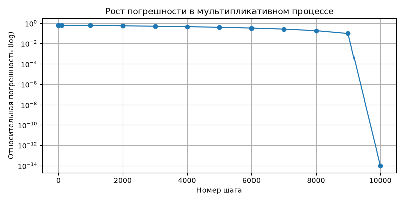

# Отчет: Погрешности вычислений

## Блок 1. Абсолютная и относительная погрешность

**Задача 1.**
Порядок по Δx и δx не совпадает. Абсолютная погрешность зависит от масштаба числа, а относительная показывает долю ошибки.

**Задача 2.**
По абсолютной ошибке сильнее ошибся инженер с болтом. Но в процентах ошибка с мостом ничтожна (0.24%), а с болтом велика (3%). Выбор зависит от критичности ошибки.

**Задача 3.**
Функция корректно считает относительную погрешность и не падает при делении на ноль.

**Задача 4.**
Диапазон точного значения составляет от 47.2527 до 47.3473.

**Задача 5.**
Датчик B точнее только в узком диапазоне температур. При выходе за 60 градусов абсолютная погрешность B превысит 0.3.

## Блок 2. Значащие цифры и округление

**Задача 6.**
Запись чисел с нулями на конце (1200, 250000) неоднозначна. Экспоненциальная форма делает количество значащих цифр однозначным.

**Задача 7.**
Осталось 3 значащие цифры. Запись 4.738291 ± 0.02 неверна, так как точность измерения не позволяет указывать столь мелкие доли.

**Задача 8.**
Python использует банковское округление (к четному). При школьном правиле на миллионе чисел накопится систематический сдвиг, что критично в финансах.

**Задача 9.**
Ошибка с промежуточным округлением значительно больше. Округлять промежуточные результаты нельзя.

## Блок 3. Накопление ошибки и float-эксперименты

**Задача 10.**
0.1 не представимо точно в двоичной системе, поэтому при сложении возникает микроскопическая ошибка, ломающая проверку на равенство.

**Задача 11.**
Прямое вычитание близких чисел дает огромную относительную ошибку. Использование сопряженной формулы решает проблему.

**Задача 12.**
`math.fsum` самый точный. Наивный цикл и `sum()` накапливают погрешность.

**Задача 13.**
Сложение малых чисел с большими приводит к потере малых. Правильная стратегия — сначала суммировать малые числа.

**Задача 14.**

Погрешность растет экспоненциально. График сохранен в `plot.png`.

**Задача 15.**
`float` накапливает ошибку. `Decimal` и целочисленная арифметика в копейках дают точный результат, поэтому в финансах `float` не используют.