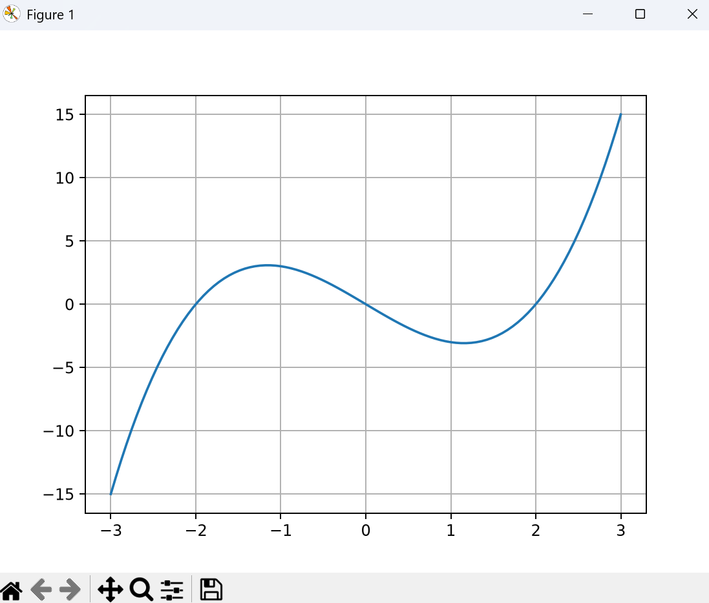
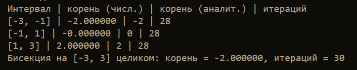
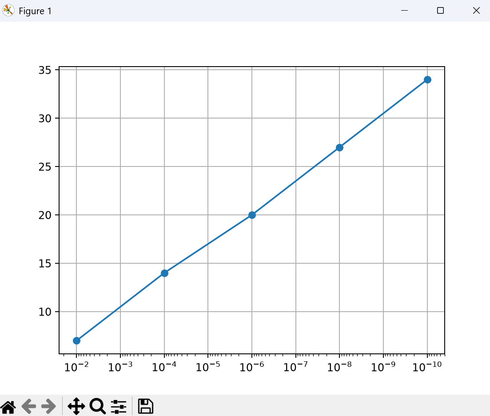

# Отчет по домашнему заданию: Локализация корня и метод половинного деления

## Задача 1. Базовая бисекция с журналом

Для функции $f(x) = x^3 - 2x - 5$ проверена смена знака на отрезке $[2, 3]$: $f(2) = -1$, $f(3) = 16$. Метод половинного деления с точностью $\varepsilon = 10^{-6}$ сошелся к корню $\approx 2.094551$. При подстановке в функцию полученное значение по модулю строго меньше \(10^{-6}\).

По результатам работы алгоритма длина интервала впервые стала меньше \(10^{-6}\) на 20-й итерации. Это число полностью совпадает с теоретической оценкой $\log_2(\Delta_0 / \varepsilon) = \log_2(1 / 10^{-6}) \approx 19.93$, что подтверждает корректность формулы.

## Задача 2. Все корни на отрезке

Для функции $f(x) = x^3 - 4x$ на отрезке $[-3, 3]$ были локализованы три интервала со сменой знака: $[-3, -1]$, $[-1, 1]$ и $[1, 3]$. Применение бисекции с точностью \(10^{-8}\) к каждому из них дало корни, которые совпали с аналитическим решением $x(x-2)(x+2)=0$, то есть \(-2, 0\) и \(2\).

Число итераций для всех трех корней оказалось одинаковым, так как оно зависит исключительно от начальной ширины интервала (которая везде равна 2) и заданной точности, но не от вида функции. Если применить метод к интервалу $[-3, 3]$ целиком, алгоритм найдет только корень \(x = 0\), так как при первом же делении пополам середина попадает ровно в этот корень.

## Задача 3. Влияние точности на число итераций

Для функции $f(x) = e^x - 3x$ был локализован корень на отрезке $[0, 1]$ (смена знака подтверждена). При запуске алгоритма с разной точностью от \(10^{-2}\) до \(10^{-10}\) было установлено, что график зависимости числа итераций от точности в полулогарифмических координатах представляет собой прямую линию.

Каждое увеличение точности на 2 порядка добавляет ровно 7 итераций, что совпадает с теорией (\(\log_2(100) \approx 6.64\)). Метод бисекции называют гарантированно сходящимся, так как он всегда работает при наличии смены знака, но медленным, поскольку отбрасывает лишь половину интервала за шаг и требует множества вычислений для достижения высокой точности.

