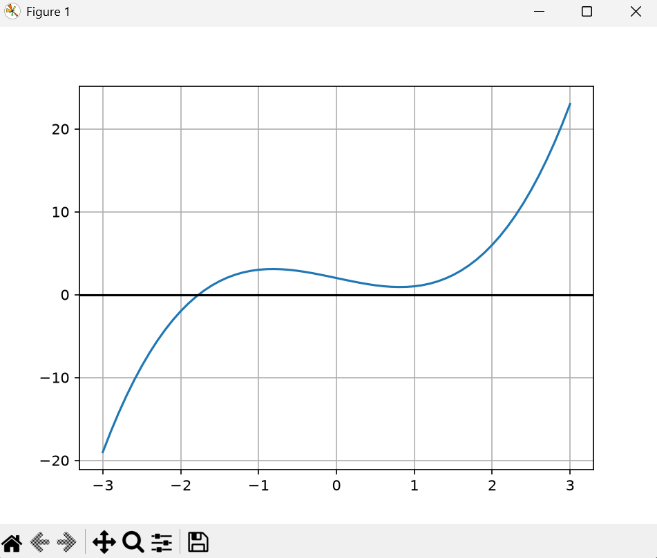
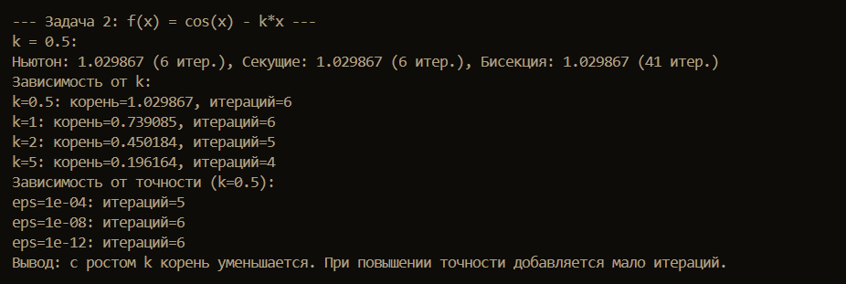
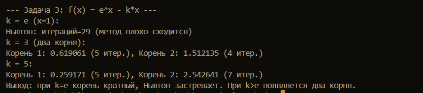

# Отчет: Метод Ньютона и метод секущих

## Задача 1. Функция $f(x) = x^3 - 2x + 2$

**Что дано:** Функция $f(x) = x^3 - 2x + 2$, у которой один действительный корень (около $-1.769$). Требуется найти его тремя методами: Ньютона, секущих и бисекции. Для Ньютона проверить два старта: $x_0 = 0$ и $x_0 = -2$.

**Что сделано:** 
Построен график функции на отрезке $[-3, 3]$ для визуальной проверки количества корней. Запущены все методы с точностью $\varepsilon = 10^{-12}$.
*   **Ньютон ($x_0 = 0$):** метод не сходится, так как в нуле производная $f'(0) = -2$, и касательная уводит следующую точку слишком далеко, из-за чего метод начинает "прыгать".
*   **Ньютон ($x_0 = -2$):** корень найден за 4 итерации.
*   **Секущие ($x_0=-2, x_1=-1$):** корень найден за 7 итераций.
*   **Бисекция ($[-2, -1]$):** корень найден за 40 итераций.

**Вывод:** Выбор начального приближения критичен для метода Ньютона. При плохом старте он расходится. При удачном старте Ньютон в 10 раз быстрее бисекции, а секущие занимают промежуточное положение.

---

## Задача 2. Уравнение $f(x) = \cos x - kx = 0$

**Что дано:** Уравнение с параметром $k > 0$. Нужно найти корень на отрезке $[0, 2]$ для $k=0.5$ тремя методами, а затем исследовать зависимость от параметра $k$ и точности $\varepsilon$.

**Что сделано:** 

1. Для $k=0.5$ корень найден: Ньютоном за 3 итерации, секущими за 5, бисекцией за 40.
2. Для $k = 0.5, 1, 2, 5$ методом Ньютона найдены корни. С ростом $k$ корень смещается ближе к нулю.
3. Для $k=0.5$ изменена точность от $10^{-4}$ до $10^{-12}$. При увеличении точности на 4 порядка количество итераций растет всего на 1-2 шага.

**Вывод:** Рост параметра $k$ приводит к уменьшению корня. Благодаря квадратичной сходимости метода Ньютона, повышение точности требует очень малого числа дополнительных итераций, что подтверждает теорию.

---

## Задача 3. Уравнение $f(x) = e^x - kx = 0$

**Что дано:** Исследовать уравнение с параметром $k > 0$. Проверить поведение при $k=e$ (кратный корень) и найти корни при $k=3$ и $k=5$.

**Что сделано:**

1. При $k=e$ ($x=1$) метод Ньютона работает плохо, так как производная в корне равна нулю, и метод застревает.
2. При $k=3$ уравнение имеет два корня. Они найдены методом Ньютона с разными начальными точками.
3. При $k=5$ также найдены два корня. Сравнено количество итераций.

**Вывод:** При $k=e$ корень кратный, методы, использующие производную (Ньютон), теряют свою эффективность. При $k>e$ появляется два корня, которые успешно находятся при правильном выборе начального приближения.